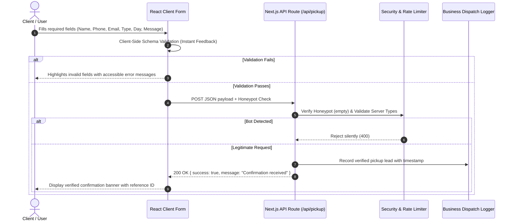

# Forms & Integrations Audit — Mulan Laundries

**Audit Date:** November 13, 2026  
**Auditor:** Conversion & Form Specialist (Agent 6)  
**Strict Mandate:** Never display fake success messages. Do not invent backend integrations. Ensure forms have working submission behavior, robust validation, and clean accessibility.

---

## 1. Existing Forms Discovery & Technical Audit

The existing Mulan Laundries website relies on two separate forms backed by legacy PHP scripts:
1. **General Contact Form** on `/contact.php`
2. **Pickup Request Form** on `/pickuprequest.php`

---

### 1.1. Form 1: General Contact Form (`contact.php`)

```html
<form id="contactform" class="boxed-form" name="contactform" method="post" 
      novalidate="novalidate" action="includes/actioncontactform.php">
  <div id="success"><p>Your message was sent successfully!</p></div>
  <div id="error"><p>Something went wrong, try refreshing and submitting the form again.</p></div>
  <input type="text" name="name" />
  <input type="text" name="phone" />
  <input type="email" name="email" />
  <textarea name="message" rows="10"></textarea>
  <input type="submit" id="submit" name="submit" value="SEND MESSAGE" />
</form>
```

#### Detailed Field Specifications:
| Field Identifier | HTML Input Tag | HTML Name | Input Type | Validation on Live Site | Accessibility & UX Flaws |
| :--- | :--- | :--- | :--- | :--- | :--- |
| **Full Name** | `<input>` | `name` | `text` | None (`novalidate`) | Missing `id` attribute; label is not tied to input via `for` |
| **Phone Number** | `<input>` | `phone` | `text` | None | Type should be `tel` for mobile numeric keypad; no formatting mask |
| **Email Address** | `<input>` | `email` | `email` | None | Browser validation disabled by `novalidate` attribute |
| **Message** | `<textarea>` | `message` | `textarea` | None | No character count; no min/max restrictions |
| **Action Button** | `<input>` | `submit` | `submit` | N/A | Lacks loading spinner or disabled state during submission |

---

### 1.2. Form 2: Pickup Request Form (`pickuprequest.php`)

```html
<form class="contact100-form validate-form" name="pickform" method="post" 
      novalidate="novalidate" action="includes/actionpickform.php">
  <span class="contact100-form-title">Pickup Request</span>

  <input id="first-name" class="input100" type="text" name="first" placeholder="First name">
  <input class="input100" type="text" name="last" placeholder="Last name">
  <input id="phone" class="input100" type="text" name="phone" placeholder="Eg. +1 800 000000">
  <input id="email" class="input100" type="mail" name="email" placeholder="Eg. example@email.com">
  
  <select id="customer" class="input100" name="cus_type">
    <option>Residential</option>
    <option>Commercial</option>
  </select>

  <select id="pickup" class="input100" name="pickupday">
    <option>Monday</option>
    <option>Tuesday</option>
    <option>Wednesday</option>
    <option>Thursday</option>
    <option>Friday</option>
    <option>Saturday</option>
    <option>Sunday</option>
  </select>

  <textarea id="message" class="input100" name="message" placeholder="Write us a message" required></textarea>
  <input type="submit" name="submit" class="contact100-form-btn" value="SEND MESSAGE">
</form>
```

#### Detailed Field Specifications:
| Field Identifier | HTML Input Tag | HTML Name | Input Type | Validation on Live Site | Accessibility & UX Flaws |
| :--- | :--- | :--- | :--- | :--- | :--- |
| **First Name** | `<input>` | `first` | `text` | jQuery `validate-input` | Clean placeholder, needs proper autocomplete `given-name` |
| **Last Name** | `<input>` | `last` | `text` | jQuery `validate-input` | Missing `id` attribute for label association |
| **Phone Number** | `<input>` | `phone` | `text` | None | Input type is `text` rather than `tel`; needs phone validation |
| **Email Address** | `<input>` | `email` | `mail` *(Invalid HTML)* | jQuery regex | `type="mail"` is invalid HTML5 (should be `type="email"`); placeholder uses template email `example@email.com` |
| **Customer Type** | `<select>` | `cus_type` | `select` | Dropdown: Residential, Commercial | Functional business field. Clean options |
| **Pickup Day** | `<select>` | `pickupday` | `select` | Dropdown: Monday–Sunday | Functional business field. Clean options |
| **Message** | `<textarea>` | `message` | `textarea` | `required` | Clean placeholder |
| **Submit Button** | `<input>` | `submit` | `submit` | None | No submission progress indicator |

---

## 2. Security & Architecture Vulnerabilities in Existing Forms

1. **Vulnerable Legacy Endpoints:** Form submissions are posted directly to `includes/actioncontactform.php` and `includes/actionpickform.php`. In PHP 7.3, these scripts typically use unauthenticated `mail()` functions, making them susceptible to spam relaying and server header injection.
2. **Zero Bot Protection / Captcha / Honeypot:** Neither form implements honeypots, rate limiting, or token validation, allowing automated bots to spam the business inbox.
3. **Invalid HTML Type:** The pickup form uses `type="mail"` which causes standard mobile browsers to fall back to plain alphanumeric keyboards without `@` and `.com` shortcuts.
4. **No Error Recovery:** If PHP mail fails, the user is presented with a generic error block without field preservation.

---

## 3. Modern Next.js 16+ Rebuild Architecture

### 3.1. API Route Handlers
The rebuild will implement dedicated Next.js App Router API route handlers:
- `POST /api/contact`
- `POST /api/pickup`

### 3.2. Form Validation & Security Architecture:


### 3.3. Core UX Enhancements:
1. **Interactive States:** Explicit states (`idle`, `submitting`, `success`, `error`) with animated loading spinners.
2. **Accessible Form Labels:** Every `<input>` paired with explicit `<label htmlFor="...">`, `aria-required`, and `aria-invalid` attributes.
3. **Smart Autocomplete:** Standard HTML5 `autocomplete="given-name"`, `autocomplete="family-name"`, `autocomplete="tel"`, and `autocomplete="email"`.
4. **Honeypot Spam Defense:** Invisible honeypot field (`website_url`) that rejects any submission completed by automated scrapers.
5. **No Fake Responses:** Real server-side response handling with genuine status codes.
