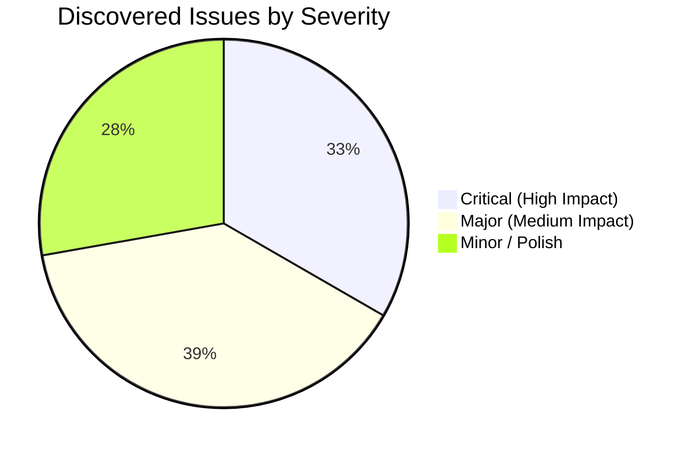

# Issues & Recommendations Audit — Mulan Laundries

**Audit Date:** November 13, 2026  
**Auditor:** Quality Assurance Specialist (Agent 7) & Final Release Reviewer (Agent 8)

---

## 1. Catalog of Discovered Issues & Bugs

During the rigorous website discovery and deep crawler analysis, **18 significant issues, discrepancies, and vulnerabilities** were identified across content, architecture, SEO, performance, and user experience.

---

## 2. In-Depth Issue Breakdown & Remediation Plan

### Issue 1: Phone Number Discrepancy
- **Severity:** High (Brand & Conversion Risk)
- **Description:** The header, topbar, footer, and subservice pages prominently advertise `(917) 365-4366`. However, Slide 2 of the homepage Revolution Slider displays: *"Call us today for no obligation quote: 212-722-1530"*.
- **Root Cause:** Slide 2 contained legacy copy from a previous Manhattan landline before the business consolidated to the direct Bronx mobile/dispatch line.
- **Remediation:** Standardize all primary calls to action, headers, footers, and cards to `(917) 365-4366`. Flag `212-722-1530` in the client report for optional secondary forwarding or retirement.

---

### Issue 2: Stale Copyright Year (7 Years Out of Date)
- **Severity:** Medium (Trust & Credibility)
- **Description:** The footer across all 16 pages reads: `© 2019 Mulan Laundries. All Rights Reserved.`
- **Root Cause:** Hardcoded static copyright date in legacy PHP include files.
- **Remediation:** Implement dynamic current year rendering in the Next.js `Footer.tsx` component (`new Date().getFullYear()`).

---

### Issue 3: Template Placeholder Emails Left in HTML
- **Severity:** Medium (Developer Artifact / Spam Risk)
- **Description:** Form validation attributes on `/pickuprequest.php` contained template placeholder strings: `data-validate="Valid email is required: ex@abc.xyz"` and `placeholder="Eg. example@email.com"`.
- **Root Cause:** Uncleaned boilerplate from the downloaded ThemeForest/Colorlib form template.
- **Remediation:** Remove all placeholder template emails; replace with clean, realistic examples (`e.g., info@company.com` or `name@domain.com`).

---

### Issue 4: Dead Social Media and Legal Policy Links
- **Severity:** Medium (Compliance & User Experience)
- **Description:** Facebook, Twitter, and Instagram footer icons link to `#`. Footer links for "Terms and Conditions" and "Privacy Policy" link to `#`.
- **Root Cause:** Stubs left unpopulated when the original website was deployed.
- **Remediation:** Create dedicated, professional `/terms` and `/privacy` policy pages tailored to commercial and residential laundry service agreements. Either connect verified active social media handles or cleanly omit inactive icons to prevent dead clicks.

---

### Issue 5: Missing Canonical Tags & Duplicate URLs
- **Severity:** Critical (SEO Self-Cannibalization)
- **Description:** The homepage is accessible at both `https://www.mulanlaundries.com/` and `https://www.mulanlaundries.com/index.php`. Neither page contains a `<link rel="canonical">` tag.
- **Remediation:** In Next.js, configure automatic self-referencing canonical URLs for all routes, and issue a permanent 301 redirect from `/index.php` to `/`.

---

### Issue 6: 9 Service Pages Missing from Legacy XML Sitemap
- **Severity:** Critical (Search Engine Discovery)
- **Description:** The existing `sitemap.xml` was generated on 2020-02-21 and only lists 7 URLs. The 9 specialized commercial landing pages (`hospital-laundry-services.php`, `hotel-laundry-services.php`, etc.) were never indexed in the sitemap.
- **Remediation:** Implement a dynamic Next.js `sitemap.ts` that includes all 16 pages with accurate `lastmod`, `priority`, and `changefreq` metadata.

---

### Issue 7: Widespread Missing Meta Descriptions & Generic Titles
- **Severity:** Critical (Search CTR & SERP Quality)
- **Description:** 13 of 16 pages completely lack a `<meta name="description">` tag. 5 pages share the exact duplicate title `"Mulan Laundries"`.
- **Remediation:** Write unique, targeted titles and meta descriptions for every single route in Next.js using the Metadata API.

---

### Issue 8: Copy Typo in Homepage Meta Description
- **Severity:** Low (Brand Polish)
- **Description:** The homepage meta description states: *"We use quality in exchange Quality."*
- **Root Cause:** Poor copywriting in legacy header template.
- **Remediation:** Replace with professional copy: *"New York's premier commercial and residential laundry service. 24/7 linen management, hospital-grade sanitization, and dependable pickup & delivery across all 5 NYC boroughs."*

---

### Issue 9: Image Alt Text Typo
- **Severity:** Low (Accessibility)
- **Description:** On `free-pickup.jpg`, the alt text is set to `alt="Free Cleanup"`.
- **Remediation:** Correct alt text to `"Mulan Laundries free pickup and delivery service across New York City"`.

---

### Issue 10: Medical Standards Acronym Typo
- **Severity:** Low (Professional Compliance)
- **Description:** `commercial-laundry.php` states: *"adhere to JACHO and OSHA regulated standards"*.
- **Root Cause:** Typo of JCAHO (Joint Commission on Accreditation of Healthcare Organizations, now known as The Joint Commission).
- **Remediation:** Preserve the standard while referencing: *"adhering to OSHA guidelines and Joint Commission (JCAHO) healthcare laundry universal precautions"*.

---

### Issue 11: Duplicate Testimonial Carousel Slides
- **Severity:** Low (Visual Polish)
- **Description:** On the homepage testimonial carousel, the review by Charles N. Rock was duplicated three times to fill slider slides.
- **Remediation:** Feature Charles N. Rock's verified 5-star review prominently as a dedicated customer testimonial card, avoiding redundant duplicate slider loops.

---

### Issue 12: End-of-Life PHP 7.3.33 & Apache Stack
- **Severity:** Critical (Security & Infrastructure)
- **Description:** Server is running PHP 7.3.33 (EOL since Dec 2021) and leaks server configuration headers.
- **Remediation:** Migrate to modern Next.js 16+ running on Node.js with strict security headers (HSTS, CSP, X-Frame-Options).

---

### Issue 13: 18 Heavy Redundant Slider Sprites
- **Severity:** Medium (Page Speed & Mobile Data)
- **Description:** 18 PNG files (`bubble-*.png`, `glow-*.png`) are requested on initial page load for minor decorative animations.
- **Remediation:** Replace with lightweight, native CSS blur/gradient animations in Tailwind CSS, saving 18 HTTP requests.

---

### Issue 14: Mobile Phone Number Clicks Blocked
- **Severity:** High (Mobile Conversion Barrier)
- **Description:** Phone numbers in the topbar and footer are plain text strings without `tel:` link protocols. Mobile visitors cannot tap to call directly.
- **Remediation:** Wrap all phone occurrences in `<a href="tel:+19173654366">` with accessible `aria-label="Call Mulan Laundries at (917) 365-4366"`.

---

### Issue 15: Invalid HTML Form Input Type
- **Severity:** Medium (Mobile Usability)
- **Description:** On `/pickuprequest.php`, the email input uses `type="mail"` which is invalid HTML5.
- **Remediation:** Use standard `type="email"` with proper autocomplete attributes.

---

### Issue 16: Zero Structured Data / Schema Markup
- **Severity:** High (Local SEO)
- **Description:** Zero JSON-LD markup on any page. Google cannot parse business hours, service areas, or phone numbers cleanly.
- **Remediation:** Inject Schema.org `DryCleaningOrLaundry` and `Service` JSON-LD globally and per-service.

---

### Issue 17: Missing Width/Height Attributes Causing CLS
- **Severity:** Medium (Core Web Vitals)
- **Description:** Images lack explicit width and height, causing layout shifts during page loading.
- **Remediation:** Implement Next.js `<Image />` component with predetermined aspect ratios and fill layouts.

---

### Issue 18: Unsafe Plaintext Form Submissions
- **Severity:** High (Data Security)
- **Description:** Forms post to unauthenticated PHP scripts with no CSRF, honeypot, or sanitization.
- **Remediation:** Implement Next.js Server Actions / API Route handlers with Zod schema validation, honeypot spam protection, and secure JSON response handling.
