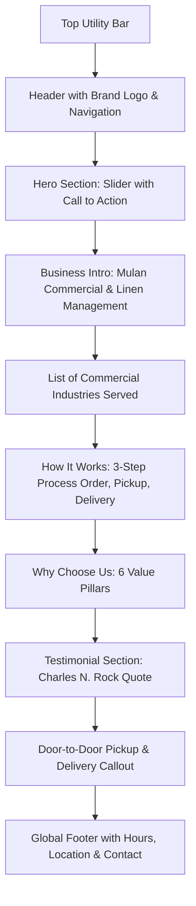
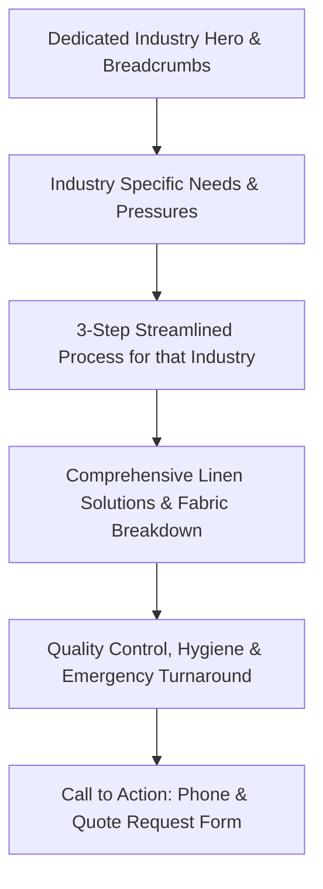

# Page Structure & Layout Analysis — Mulan Laundries

**Audit Date:** November 13, 2026  
**Auditor:** UI/UX Design Architect (Agent 3) & Frontend Architect (Agent 4)

---

## 1. Global Layout Architecture (Header & Footer)

Every page on the existing Mulan Laundries website shares a common global envelope constructed with Bootstrap 3 markup:

### 1.1. Global Topbar
```html
<div class="top-bar">
  <div class="contact-info">
    <span>(917) 365-4366</span>
    <span>Mon.- Sun. 24x7</span>
    <span>New York City Bronx</span>
  </div>
</div>
```
- **Evaluation:** Features vital trust signals (phone, 24/7 hours, Bronx NYC location) but lacks interactive HTML anchors (`tel:` links), causing friction on mobile devices.

### 1.2. Primary Navigation Bar
```html
<header class="navbar navbar-default">
  <div class="logo">
    <a href="/"></a>
  </div>
  <nav class="nav-links">
    - HOME
    - About
    - COMMERCIAL SERVICE [Dropdown: 9 items]
    - WASH AND FOLD SERVICES
    - CONTACT US
    - PICKUP REQUEST (Styled as an action button)
  </nav>
</header>
```
- **Evaluation:** Clean hierarchy. The dropdown contains all 9 commercial verticals. The mobile hamburger menu relies on legacy jQuery/Bootstrap JavaScript which often glitches on modern iOS Safari and Android Chrome.

### 1.3. Global Footer
```html
<footer>
  - Column 1: Brand logo (`images/new-logo-footer1.webp`)
  - Column 2: Promo banner "Get Started Today! (917) 365-4366" + Social icons (# links)
  - Column 3: Hours "Services provided Mon.- Sun. 24x7"
  - Column 4: Location "New York City Bronx"
  - Column 5: Copyright "© 2019 Mulan Laundries. All Rights Reserved."
  - Column 6: Legal links "Terms and Conditions", "Privacy Policy" (# dead anchors)
</footer>
```
- **Evaluation:** Lacks proper semantic HTML (`<nav>`, `<address>`, proper headings). Social links and legal policy links are unlinked `#` stubs.

---

## 2. Structural Breakdown of Key Pages

### 2.1. Homepage (`index.html`) Section Hierarchy


#### Detailed Section Components on Homepage:
1. **Hero Banner:** Full-width slider with background images of commercial laundry machinery, folded linens, and delivery vans. Headline: *"Mulan Laundries is Best-in-class Commercial laundry service and linen management company in New York."*
2. **Value Introduction Block:** 2-column layout. Left column has commercial introduction and green technology commitments. Right column has bullet points of industries served (Hotels, Fitness Centers, Corporate Gyms, Restaurants, etc.).
3. **"How It Works: in 3 Easy Steps":** 3-column card block featuring icons, stage numbers (01, 02, 03), and process text (Order -> Pickup -> Delivery). Includes a 4th CTA card: *"Click Here to Order Now"*.
4. **"Why Choose Us":** 6-card feature grid highlighting:
   - Personalized Experience
   - Affordable Pricing
   - Convenience
   - Quality
   - Express Delivery
   - Instant Order Update
5. **Customer Reviews Section:** Quote card featuring Charles N. Rock with 5 star icons.
6. **Delivery Action Callout:** Promo banner encouraging residential and commercial clients to offload their laundry chores with direct CTA to pickup request.

---

### 2.2. About Us (`about.php`) Section Hierarchy
1. **Sub-Hero Banner:** Page title *"Mulan Laundry Services: pick up, wash, dry, fold – Commercial and Residential"* with breadcrumb navigation (`Home / About`).
2. **Company Mission & Narrative:** Detailed multi-paragraph overview of the company's 18-year history, 5 operating hubs in NYC, universal hygiene precautions, and door-to-door convenience.
3. **Team Section Heading:** Contains headers *"OUR TEAM"* and *"Mulan Laundry services: Team"*, emphasizing the expert staff handling linens with care and precision.
4. **Secondary Banner:** Callout to commercial services with quote request button.

---

### 2.3. Commercial Laundry Hub (`commercial-laundry.php`) Section Hierarchy
1. **Page Title Header:** *"Commercial laundry services in New York"* with breadcrumb.
2. **Operational Statistics Banner:** Highlights processing over 1,000,000 pounds per year and universal precaution standards under OSHA and JCAHO guidelines.
3. **Textile Preservation & Process:** Highlights custom detergent formulas that extend linen life and dedicated commercial account managers.
4. **Industry Target Grid:** Links and callouts to commercial verticals (Hotels, Gyms, Spas, Medical Facilities, Short-Term Rentals).
5. **Contact / Quote CTA:** Direct link to schedule a consultation or commercial quote.

---

### 2.4. Wash & Fold Services (`wash-fold.php`) Section Hierarchy
1. **Page Title Header:** *"Wash/fold laundry services New York"* with breadcrumb.
2. **Service Details & Hygiene Standards:** Explains separation of white and colored garments, premium washing formulas, and neatly bundled delivery.
3. **Eco-Friendly Detergent Highlights:** Prominent callout for ECOS, allergy-free, and Oxi-Clean options.
4. **Special Handling & Surcharge Policy:** Clear disclaimer explaining that oversized items (comforters, duvets, blankets, rugs, mats, pillows) require dedicated wash cycles and are subject to separate fees.
5. **Action Section:** CTA button to schedule residential pickup.

---

### 2.5. Specialized Commercial Service Landing Pages (9 Pages)
Each of the 9 specialized commercial landing pages follows a high-converting layout pattern:



- **Header / Breadcrumb:** Clear industry title (e.g. *"Hospital Laundry Services"*, *"Laundry Services for Hotels"*).
- **Executive Pitch:** Addressing the exact operational challenges of that industry (e.g., rapid guest turnovers for Airbnb, sanitary requirements for hospitals, peak class volume for gyms).
- **Three-Step Workflow:** Customized to the specific sector's pickup frequency and delivery timing.
- **Specific Linen Solutions Grid:** 4-to-6 category breakdown (e.g., Bedding, Towels & Bath Linens, Table Linens, Staff Uniforms, Specialty Fabrics).
- **Emergency Service Feature:** Highlights same-day or on-demand surge support when sudden laundry crises arise.
- **Direct Conversion Section:** Phone link `(917) 365-4366` and link to pickup request.

---

### 2.6. Contact & Pickup Request Pages (`contact.php` & `pickuprequest.php`)

#### Contact Page Layout:
- **Left Column (40% width):** Business contact information:
  * Address: New York City, Bronx
  * Phone: (917) 365-4366
  * Hours: Mon.- Sun. 24x7
  * Email: info@mulanlaundries.com
- **Right Column (60% width):** Direct inquiry form with fields: Name, Phone, Email, Message, and Submit button.

#### Pickup Request Page Layout:
- **Centered Clean Card Container:** Form title *"Pickup Request"*.
- **Customer Information Fields:** First Name, Last Name, Phone, Email.
- **Service Configuration Dropdowns:**
  * Customer Type (Residential / Commercial)
  * Preferred Pickup Day (Monday through Sunday)
- **Special Instructions:** Multi-line text area for specific laundry instructions or pickup details.
- **Submit Action Button:** High-contrast CTA *"SEND MESSAGE"*.

---

## 3. Recommended Modernized Next.js 16+ Component Tree

To maintain clean code separation, modularity, and rapid server-side rendering, the rebuild will decompose these layouts into the following modern React Server and Client Components:

```
src/
├── components/
│   ├── layout/
│   │   ├── TopBar.tsx               (Utility banner with phone, hours, location)
│   │   ├── Navbar.tsx               (Responsive navigation with accessible dropdown)
│   │   ├── MobileMenu.tsx           (Accessible sliding mobile navigation drawer)
│   │   └── Footer.tsx               (Semantic footer with links, copyright, contact)
│   ├── ui/
│   │   ├── Button.tsx               (Accessible, customizable CTA button)
│   │   ├── Card.tsx                 (Clean elevated cards with soft borders)
│   │   ├── SectionHeading.tsx       (Consistent title, subtitle, and badge display)
│   │   └── Badge.tsx                (Status and feature pill badges)
│   ├── sections/
│   │   ├── HeroSlider.tsx           (Modern CSS-driven smooth hero carousel)
│   │   ├── BusinessIntro.tsx        (Brand story & 18-year legacy overview)
│   │   ├── HowItWorks.tsx           (3-step visual process cards)
│   │   ├── WhyChooseUs.tsx          (6 value proposition cards)
│   │   ├── IndustriesGrid.tsx       (Interactive grid linking to all 9 verticals)
│   │   ├── TestimonialCard.tsx      (Verified customer review component)
│   │   ├── CommercialOverview.tsx   (1,000,000 lbs volume & OSHA/JCAHO standards)
│   │   ├── WashFoldBreakdown.tsx    (Separation, eco-friendly detergents, item policy)
│   │   └── CallToActionBanner.tsx   (High-converting quote & pickup banner)
│   └── forms/
│       ├── ContactForm.tsx          (Interactive contact form with real validation)
│       └── PickupRequestForm.tsx    (Complete scheduling form with client validation)
```
