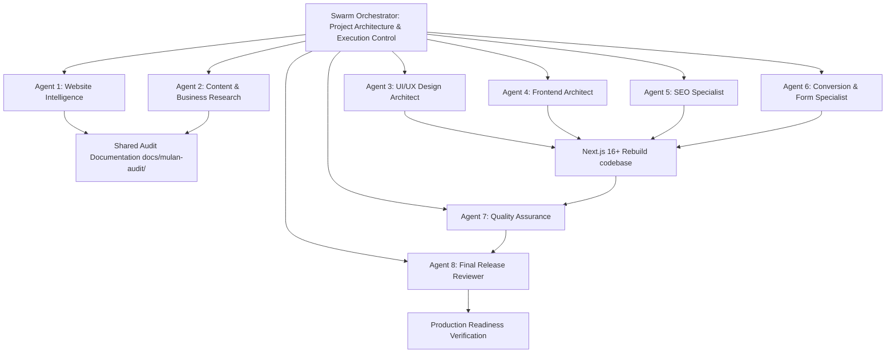
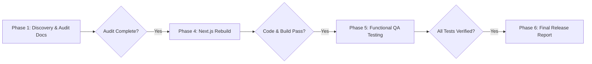

# Next.js 16+ Rebuild Plan & Multi-Agent Swarm Roadmap

**Project:** Mulan Laundries Website Rebuild  
**Execution:** Google Antigravity Multi-Agent Swarm  
**Lead Architect & Swarm Orchestrator:** Antigravity Coordinator  
**Target Framework:** Next.js 16+ (App Router), TypeScript, Tailwind CSS  
**Audit Reference:** `docs/mulan-audit/`

---

## 1. Multi-Agent Swarm Operational Roles

| Agent | Core Responsibility | Primary Artifacts & Deliverables |
| :--- | :--- | :--- |
| **Agent 1: Website Intelligence** | Complete crawl, URL discovery, asset capture, page mapping | `website-inventory.md`, `crawler/raw_pages/`, `crawler/audit_data.json` |
| **Agent 2: Content & Business Research** | Extract all business content, claims, services; flag discrepancies | `content-inventory.md`, `service-inventory.md`, `full_content_dump.json` |
| **Agent 3: UI/UX Design Architect** | Premium visual system, typography, colors, responsive layouts | Design system tokens, `page-structure.md`, UI component guidelines |
| **Agent 4: Frontend Architect** | Next.js 16+ App Router setup, TypeScript configuration, components | Clean App Router codebase, reusable React components, asset pipeline |
| **Agent 5: SEO Specialist** | Metadata API, Schema.org JSON-LD, 301 redirects, sitemap & robots | `seo-audit.md`, `sitemap.ts`, `robots.ts`, `next.config.ts` redirects |
| **Agent 6: Conversion Specialist** | Contact & pickup forms, real validation, API handlers, spam defense | `forms-and-integrations.md`, `/api/contact`, `/api/pickup`, client forms |
| **Agent 7: Quality Assurance** | End-to-end testing across routes, breakpoints, forms, links | Functional test matrix, evidence logs, responsive verification |
| **Agent 8: Final Release Reviewer** | Code review, accessibility check, content accuracy audit, final signoff | `final-report.md`, deployment checklist |

---

## 2. Technical Stack & Architectural Decisions

### 2.1. Technology Selection:
- **Core Framework:** Next.js 16+ with React 19 and App Router architecture.
- **Language:** TypeScript 5+ (Strict mode, zero `any` types).
- **Styling:** Tailwind CSS with custom design tokens for Mulan Laundries' brand identity.
- **Icons:** Lucide React (High-performance vector iconography) + verified legacy PNG icons.
- **Image Optimization:** Next.js `<Image />` component with automatic WebP/AVIF compression.
- **State & Form Management:** React Hooks with client-side and server-side validation.
- **API Architecture:** Next.js Route Handlers (`/api/contact/route.ts`, `/api/pickup/route.ts`).

### 2.2. Design System Tokens (Phase 3 Alignment):
- **Backgrounds:** Clean crisp whites (`#FFFFFF`, `#F8FAFC`, `#F1F5F9`).
- **Typography:** Deep Navy (`#0F172A`, `#1E293B`, `#334155`) for high contrast and readability.
- **Primary Brand Accents:** Soft & Vibrant Blues (`#0284C7` sky-600, `#0369A1` sky-700, `#38BDF8` sky-400).
- **Clean Border & Elevation:** Soft borders (`#E2E8F0`), subtle drop-shadows (`shadow-sm`, `shadow-md`), rounded cards (`rounded-xl`).
- **Photography:** Clean commercial laundry equipment, folded linens, delivery vehicles, and healthcare/hospitality scenes.

---

## 3. Route Map & Preservation Architecture

| Target Route | Source Legacy URL | Preservation & Function |
| :--- | :--- | :--- |
| `/` | `/` and `/index.php` | Full Homepage with all 13 required sections |
| `/about` | `/about.php` | Company history (18+ years), team, mission, 5 NYC hubs |
| `/commercial-laundry` | `/commercial-laundry.php` | Commercial laundry hub, 1,000,000+ lbs capacity, OSHA/JCAHO standards |
| `/wash-fold` | `/wash-fold.php` | Residential wash & fold, eco detergents, item policies |
| `/contact` | `/contact.php` | Working contact form, Bronx address, 24/7 hours, phone |
| `/pickup-request` | `/pickuprequest.php` | Complete interactive pickup scheduling flow |
| `/services/hospital-laundry` | `/hospital-laundry-services.php` | Specialized Healthcare & Hospital landing page |
| `/services/short-term-rentals` | `/laundry-services-short-term-residential-buildings.php` | Specialized Short-Term Rentals & Airbnb landing page |
| `/services/health-clubs` | `/laundry-services-health-clubs.php` | Specialized Health Clubs & Wellness landing page |
| `/services/schools-dorms` | `/laundry-services-schools-dorms.php` | Specialized Schools, Colleges & Dorms landing page |
| `/services/shelter-homes` | `/laundry-services-shelter-homes.php` | Specialized Shelter Homes & Non-Profits landing page |
| `/services/salons-spas` | `/laundry-services-salons-spas.php` | Specialized Salons & Spas landing page |
| `/services/gyms` | `/laundry-services-gyms.php` | Specialized Gyms & Fitness Centers landing page |
| `/services/hotel-laundry` | `/hotel-laundry-services.php` | Specialized Hotels & Hospitality landing page |
| `/services/bed-and-breakfast` | `/bed-and-breakfast-laundry-services.php` | Specialized Bed & Breakfast landing page |
| `/terms` | *(New route)* | Resolves dead `#` link in legacy footer |
| `/privacy` | *(New route)* | Resolves dead `#` link in legacy footer |

---

## 4. Homepage Section Plan (13 Sequential Sections)

1. **Premium Topbar & Global Navigation:** Phone `(917) 365-4366`, 24x7 hours, Bronx NYC location, responsive navigation with commercial dropdown, and primary CTA button.
2. **Hero Section:** High-impact headline: *"Best-in-class Commercial Laundry & Linen Management in New York"*, supporting subheadline, dual CTAs ("Schedule Pickup" and "Request Commercial Quote"), and dynamic imagery.
3. **Primary CTA Quick-Action Bar:** Immediate access to phone booking and instant quote request.
4. **Business Introduction:** The Mulan Laundries story, 18-year heritage, NYC operational reach across all 5 boroughs, green technology commitment.
5. **Commercial Laundry Services Overview:** 1,000,000+ lbs/year capacity, OSHA and Joint Commission adherence, dedicated account managers.
6. **Residential Wash & Fold Feature:** Separation of whites and colors, ECOS & Oxi-Clean eco detergents, wrinkle-free bundling, transparent oversized item pricing.
7. **How It Works (3 Easy Steps):** Step 1: Order -> Step 2: Pickup -> Step 3: Delivery, with clear actionable cards.
8. **Why Choose Mulan Laundries (6 Pillars):** Personalized Experience, Affordable Pricing, Convenience, Quality, Express Delivery, Instant Order Updates.
9. **Business Industries Served:** High-converting visual grid linking to all 9 specialized commercial landing pages.
10. **Verified Customer Testimonials:** Charles N. Rock's verified 5-star review displayed with clean testimonial card styling.
11. **Door-to-Door Pickup & Delivery CTA Banner:** Prominent commercial & residential pickup invitation.
12. **Contact & Location Information:** Direct phone line, verified email `info@mulanlaundries.com`, operating hours, and service areas.
13. **Professional Semantic Footer:** Dynamic copyright year, logo, quick links, legal policies, and accessibility tags.

---

## 5. Execution Steps & Quality Gates

1. **Step 1 (Complete):** Crawl entire live website, extract all assets, author all 9 audit documents in `docs/mulan-audit/`.
2. **Step 2:** Scaffold Next.js 16+ project inside `C:\Users\alvin monir\.gemini\antigravity\scratch\mulan-laundries`.
3. **Step 3:** Configure Tailwind CSS, fonts, typography, color palette, and asset pipeline with verified images.
4. **Step 4:** Build layout components (`TopBar`, `Navbar`, `Footer`, `MobileMenu`).
5. **Step 5:** Build homepage sections with exact verified business content.
6. **Step 6:** Build all 12 inner pages (`/about`, `/commercial-laundry`, `/wash-fold`, `/contact`, `/pickup-request`, and all 9 specialized service landing pages, plus `/terms` and `/privacy`).
7. **Step 7:** Implement API routes `/api/contact` and `/api/pickup` with real validation, honeypot protection, and response states.
8. **Step 8:** Implement SEO metadata, canonicals, 301 redirects, Open Graph, Schema.org JSON-LD, `sitemap.ts`, and `robots.ts`.
9. **Step 9:** Execute full functional QA testing: compile build, check links, test forms, verify responsive breakpoints, inspect console.
10. **Step 10:** Author comprehensive `docs/mulan-audit/final-report.md`.
