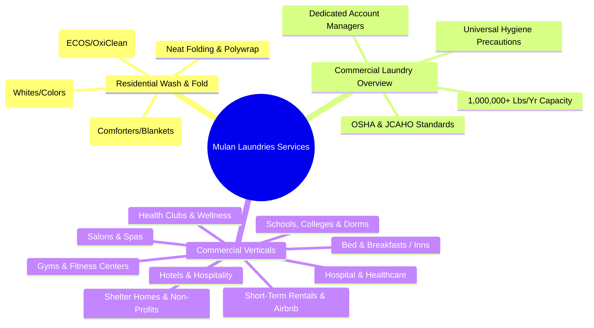

# Service & Sub-Service Inventory — Mulan Laundries

**Audit Date:** November 13, 2026  
**Auditor:** Content & Business Research Specialist (Agent 2) & Frontend Architect (Agent 4)

---

## 1. Master Service Taxonomy

Mulan Laundries provides comprehensive textile cleaning divided into two primary divisions:
1. **Commercial Laundry & Linen Management Division** (B2B): High-volume contract services for institutional, hospitality, and wellness facilities across New York City.
2. **Residential Wash & Fold Division** (B2C): Bulk door-to-door laundry services for households, busy professionals, and residential buildings.

---

## 2. Detailed Service Matrices

### 2.1. Commercial Laundry Overview (Central Hub)
- **Target Audience:** All New York businesses, corporations, and institutions requiring recurring linen supply and sanitation.
- **Key Metrics:** 1,000,000+ pounds processed per year; universal precautions adhering to OSHA and JCAHO (Joint Commission) guidelines.
- **Textiles Processed:** Towels, bedsheets, tablecloths, napkins, workwear, scrubs, blankets, robes, mats, specialty textiles.
- **Turnaround:** 24/7, 365 operational schedule; emergency turnaround within hours; daily, weekly, or bi-weekly recurring routes.
- **Dedicated Service:** Every commercial client receives a dedicated Account Specialist to manage inventory and logistics.

---

### 2.2. Residential Wash & Fold
- **Target Audience:** NYC residents, families, professionals, and corporate apartments seeking hassle-free laundry care.
- **Wash Process:**
  * Strict separation of white and colored garments into independent machines.
  * Premium detergents: ECOS eco-friendly detergent, allergy-free hypoallergenic options, and OXI-CLEAN non-chlorine oxygen bleach upon request.
  * Controlled temperature drying to prevent shrinkage and fabric degradation.
  * Prompt, crisp folding and protective packaging in transparent plastic bags or on hangers.
- **Oversized / Surcharge Items:** Clear disclaimers for comforters, duvets, heavy blankets, pillows, and rugs/mats requiring individual specialty cycles.

---

### 2.3. The 9 Dedicated Commercial Verticals

| # | Service Name | Existing URL | Clean New URL | Target Sector | Primary Linens Handled | Core Operational Differentiator |
|---|---|---|---|---|---|---|
| 1 | **Hospital Laundry Services** | `/hospital-laundry-services.php` | `/services/hospital-laundry` | Hospitals, outpatient clinics, surgical centers, healthcare facilities | Patient gowns, bed linens, towels, surgical scrubs, lab coats, blankets | Soil-level sorting to prevent cross-contamination; OSHA/JCAHO compliance; high-temp thermal sanitization; 24/7 surge coverage. |
| 2 | **Short-Term Residential Buildings** | `/laundry-services-short-term-residential-buildings.php` | `/services/short-term-rentals` | Airbnb hosts, VRBO operators, corporate housing, serviced apartments | Bed sheets, duvet covers, pillowcases, bath towels, hand towels, bath mats, kitchen linens | Rapid turnaround between check-outs and check-ins; unit-ready bundling; instant tracking notifications; emergency rush orders. |
| 3 | **Health Clubs** | `/laundry-services-health-clubs.php` | `/services/health-clubs` | Wellness centers, private fitness clubs, athletic complexes | Workout towels, locker room bath sheets, staff gear, yoga/exercise mat covers | Odor-neutralizing wash cycles; continuous towel replenishment; off-peak pickup scheduling; surge handling for peak workout times. |
| 4 | **Schools & Dorms** | `/laundry-services-schools-dorms.php` | `/services/schools-dorms` | Universities, colleges, boarding schools, student residences, prep schools | Student bedding, dining hall table linens, athletic department uniforms, residence hall communal laundry | Scalable high-volume bulk processing; separated by department or student group; hygienic wash formulas; reliable academic-calendar routes. |
| 5 | **Shelter Homes** | `/laundry-services-shelter-homes.php` | `/services/shelter-homes` | Emergency shelters, transitional housing, community shelters, non-profits | Bed linens, warm blankets, bath towels, personal resident garments, communal linens | Respectful, discreet bulk care; cost-effective non-profit contract pricing; strict universal infection precautions; dependable delivery schedules. |
| 6 | **Salons & Spas** | `/laundry-services-salons-spas.php` | `/services/salons-spas` | Day spas, beauty salons, medspas, massage clinics, nail studios | Plush facial towels, massage table sheets, robes, salon capes, headbands, esthetician linens | Heavy removal of massage oils, essential oils, chemical hair dyes, and facial masks without destroying fabric softness. |
| 7 | **Gyms & Fitness Centers** | `/laundry-services-gyms.php` | `/services/gyms` | Boxing gyms, CrossFit boxes, boutique fitness studios, athletic facilities | Sweat towels, shower towels, trainer uniforms, equipment wiping cloths, protective mat covers | Industrial odor elimination; high-temperature bacteria sanitization; high-speed turnaround to maintain continuous towel availability. |
| 8 | **Hotels & Hospitality** | `/hotel-laundry-services.php` | `/services/hotel-laundry` | Boutique hotels, luxury accommodations, commercial hotels, motels | Crisp bed sheets, duvet covers, pillow shams, luxury bath towels, bathrobes, restaurant napery, uniforms | Industrial rotary pressing and ironing; immaculate packaging; emergency on-call laundry for sudden occupancy spikes. |
| 9 | **Bed & Breakfasts** | `/bed-and-breakfast-laundry-services.php` | `/services/bed-and-breakfast` | Boutique inns, historical bed & breakfasts, guest houses | High-thread-count sheets, quilts, decorative pillowcases, bath linens, dining linens, delicate table runners | Gentle fabric-safe wash cycles for heirloom and delicate textiles; flexible pickup schedules tailored to intimate property rhythms. |

---

## 3. Service Workflow & Operational Guarantees

Across all services, Mulan Laundries commits to a standardized 3-step operational workflow:
1. **Order Initiation:** Online form submission or direct phone booking `(917) 365-4366`. Immediate order receipt and scheduling.
2. **Punctual Pickup:** Dispatch of uniformed drivers throughout Manhattan, Brooklyn, Queens, the Bronx, and Staten Island. Secure tagging and tracking.
3. **Pristine Delivery:** Items returned cleanly folded or hung, sealed in protective poly-wrap, and organized for immediate deployment.
