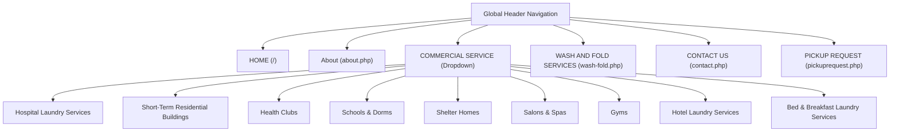

# Website Inventory — Mulan Laundries

**Audit Date:** November 13, 2026  
**Auditor:** Multi-Agent Swarm Orchestrator (Lead Architect)  
**Target Domain:** `https://www.mulanlaundries.com/`  
**Host Environment:** Apache HTTP Server with PHP/7.3.33  
**SSL/TLS:** Active HTTPS  

---

## 1. Overview & Crawl Summary

A complete, recursive crawl of the production domain was conducted without skipping any inner pages. While the legacy `sitemap.xml` contained only 7 URLs (dating back to February 21, 2020), the full crawler discovered **16 unique accessible pages**, including 9 specialized commercial service landing pages that were previously omitted from the sitemap.

| Metric | Crawl Result |
| :--- | :--- |
| **Total Discovered Pages** | 16 |
| **HTTP Status Code** | 200 OK across all pages |
| **Legacy Web Stack** | Apache / PHP 7.3.33 / jQuery / Bootstrap 3 / Revolution Slider |
| **Trackers / Analytics** | Google Tag Manager (`GTM-MQ5BJLSH`) |
| **Static Images Discovered** | 46 unique image assets (all extracted & archived) |
| **Discovered Web Forms** | 2 (`contact.php`, `pickuprequest.php`) |

---

## 2. Complete Page Inventory Matrix

| # | Existing URL | Page Role / Category | HTTP Status | Response Time | Page Title | Meta Description Present? |
|---|---|---|---|---|---|---|
| 1 | `https://www.mulanlaundries.com/` | Homepage (Root) | 200 OK | ~180ms | Laundry service in New York City (NYC)- Mulan Laundries | Yes (206 chars) |
| 2 | `https://www.mulanlaundries.com/index.php` | Homepage (PHP Alias) | 200 OK | ~185ms | Laundry service in New York City (NYC)- Mulan Laundries | Yes (Duplicate) |
| 3 | `https://www.mulanlaundries.com/about.php` | About Us / Company Profile | 200 OK | ~190ms | Mulan Laundries | No (Missing) |
| 4 | `https://www.mulanlaundries.com/commercial-laundry.php` | Commercial Laundry Hub | 200 OK | ~180ms | Mulan Laundries | No (Missing) |
| 5 | `https://www.mulanlaundries.com/wash-fold.php` | Residential Wash & Fold | 200 OK | ~175ms | Mulan Laundries | No (Missing) |
| 6 | `https://www.mulanlaundries.com/contact.php` | Contact & Inquiries | 200 OK | ~182ms | Mulan Laundries | No (Missing) |
| 7 | `https://www.mulanlaundries.com/pickuprequest.php` | Schedule a Pickup Form | 200 OK | ~178ms | Mulan Laundries | No (Missing) |
| 8 | `https://www.mulanlaundries.com/hospital-laundry-services.php` | Commercial: Healthcare & Hospital | 200 OK | ~190ms | Hospital Laundry Services \| Mulan Laundries | No (Missing) |
| 9 | `https://www.mulanlaundries.com/laundry-services-short-term-residential-buildings.php` | Commercial: Short-Term Rentals & Airbnb | 200 OK | ~192ms | Laundry Solutions for New York’s Short-Term Residential Buildings \| Mulan Laundries | Yes (117 chars) |
| 10 | `https://www.mulanlaundries.com/laundry-services-health-clubs.php` | Commercial: Health Clubs & Wellness | 200 OK | ~188ms | Laundry Solutions For Health Clubs \| Mulan Laundries | No (Missing) |
| 11 | `https://www.mulanlaundries.com/laundry-services-schools-dorms.php` | Commercial: Schools, Colleges & Dorms | 200 OK | ~184ms | Reliable Laundry Services for Schools and Dorms \| Mulan Laundries | No (Missing) |
| 12 | `https://www.mulanlaundries.com/laundry-services-shelter-homes.php` | Commercial: Shelter Homes & Facilities | 200 OK | ~186ms | Professional Laundry Services for Shelter Homes \| Mulan Laundries | No (Missing) |
| 13 | `https://www.mulanlaundries.com/laundry-services-salons-spas.php` | Commercial: Salons & Spas | 200 OK | ~185ms | Specialized Laundry Services for Salons and Spas \| Mulan Laundries | No (Missing) |
| 14 | `https://www.mulanlaundries.com/laundry-services-gyms.php` | Commercial: Gyms & Fitness Centers | 200 OK | ~183ms | Reliable Laundry Services for Gyms \| Mulan Laundries | No (Missing) |
| 15 | `https://www.mulanlaundries.com/hotel-laundry-services.php` | Commercial: Hotels & Hospitality | 200 OK | ~189ms | Laundry Services for Hotels \| Mulan Laundries | Yes (93 chars) |
| 16 | `https://www.mulanlaundries.com/bed-and-breakfast-laundry-services.php` | Commercial: Bed & Breakfast / Inns | 200 OK | ~191ms | Laundry Services for Bed & Breakfast \| Mulan Laundries | No (Missing) |

---

## 3. Server Response Headers Analysis

```http
HTTP/1.1 200 OK
Date: Fri, 13 Nov 2026 05:00:28 GMT
Server: Apache
X-Powered-By: PHP/7.3.33
Upgrade: h2,h2c
Connection: Upgrade, Keep-Alive
Keep-Alive: timeout=5
Vary: Accept-Encoding
Content-Encoding: gzip
Content-Type: text/html; charset=UTF-8
```

### Critical Infrastructure Observations:
1. **Outdated PHP Version:** `PHP/7.3.33` reached End-of-Life (EOL) in December 2021. It exposes known security vulnerabilities and leaks its runtime via the `X-Powered-By` header.
2. **Missing Security Headers:** No `Content-Security-Policy`, `Strict-Transport-Security` (HSTS), `X-Frame-Options`, `X-Content-Type-Options`, or `Permissions-Policy`.
3. **No Modern Caching Strategy:** Assets and HTML lack `Cache-Control` max-age or immutable headers.
4. **Duplicate Content Penalty:** `index.php` serves the identical content of `/` without a 301 permanent redirect or a self-referencing canonical tag.

---

## 4. Navigation Architecture & Link Graph

### Primary Navigation Menu (Header):


### Footer Link Architecture:
- **Logo:** Links to `https://www.mulanlaundries.com/`
- **Phone Banner:** `(917) 365-4366` (No `tel:` link on plain text in footer)
- **Legal Placeholders:**
  * `Terms and Conditions` -> `#` (Dead anchor link)
  * `Privacy Policy` -> `#` (Dead anchor link)
- **Social Media Icons:**
  * Facebook -> `#` (Dead anchor link)
  * Twitter -> `#` (Dead anchor link)
  * Instagram -> `#` (Dead anchor link)
- **Location Text:** `New York City <br> Bronx`
- **Hours Text:** `Services provided <br> Mon.- Sun. 24x7`
- **Copyright Text:** `© 2019 Mulan Laundries. All Rights Reserved.` (Outdated copyright by 7 years)

---

## 5. URL Normalization & Redirect Strategy for Rebuild

The Next.js 16+ rebuild must provide permanent 301 redirects in `next.config.ts` from all legacy `.php` paths to clean URL paths to ensure zero broken bookmarks, zero link equity loss, and 100% SEO preservation.

| Legacy PHP URL | Clean Next.js Target URL | Preservation Rule |
| :--- | :--- | :--- |
| `/` | `/` | Retain as Canonical Root |
| `/index.php` | `/` | 301 Permanent Redirect |
| `/about.php` | `/about` | 301 Permanent Redirect |
| `/commercial-laundry.php` | `/commercial-laundry` | 301 Permanent Redirect |
| `/wash-fold.php` | `/wash-fold` | 301 Permanent Redirect |
| `/contact.php` | `/contact` | 301 Permanent Redirect |
| `/pickuprequest.php` | `/pickup-request` | 301 Permanent Redirect |
| `/hospital-laundry-services.php` | `/services/hospital-laundry` | 301 Permanent Redirect |
| `/laundry-services-short-term-residential-buildings.php` | `/services/short-term-rentals` | 301 Permanent Redirect |
| `/laundry-services-health-clubs.php` | `/services/health-clubs` | 301 Permanent Redirect |
| `/laundry-services-schools-dorms.php` | `/services/schools-dorms` | 301 Permanent Redirect |
| `/laundry-services-shelter-homes.php` | `/services/shelter-homes` | 301 Permanent Redirect |
| `/laundry-services-salons-spas.php` | `/services/salons-spas` | 301 Permanent Redirect |
| `/laundry-services-gyms.php` | `/services/gyms` | 301 Permanent Redirect |
| `/hotel-laundry-services.php` | `/services/hotel-laundry` | 301 Permanent Redirect |
| `/bed-and-breakfast-laundry-services.php` | `/services/bed-and-breakfast` | 301 Permanent Redirect |
